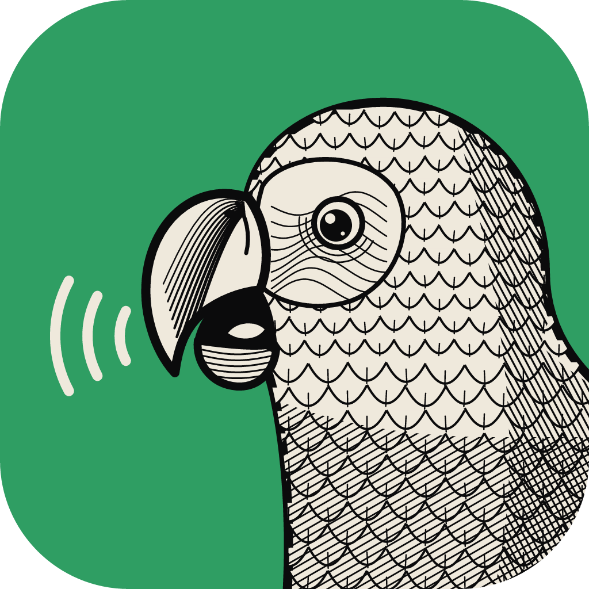

<p align="center">
  
</p>

<h1 align="center">TalkCraft</h1>

<p align="center">
  <a href="#english">English</a> · <a href="#deutsch">Deutsch</a>
</p>

<p align="center">
  <b>A podcast studio: record every speaker on their own track, cut, subtitle and publish.</b><br>
  Native on macOS, Windows and Linux, written in Rust. A fork of
  <a href="https://github.com/storytold/soundcraft">SoundCraft</a> by GERBER.MEDIA.
</p>

<a id="english"></a>

# English

## About

TalkCraft is a podcast studio for the desktop: every speaker is recorded on their own track, remote
guests join from their browser, and the episode is cut, subtitled, levelled and exported in one
place. It runs natively on macOS, Windows and Linux and is written in Rust. Underneath sits the
full SoundCraft engine (mixer, plugins, automation, CLI, MCP server); the menus leave out what a
podcast does not need.

## Features

- **Work modes.** At start TalkCraft asks "I want to … record a podcast / edit a podcast / see
  everything" and shows only the tools for that (switch any time at the left of the toolbar; after
  a recording it offers to switch to editing). Setup can turn the question off: then it starts with
  everything.
- **Podcast template.** New sessions start with a track per speaker (each on its own input, with
  a voice chain: high-pass EQ, gate, compressor, de-esser), a jingle track and a master limited to
  -1 dBTP.
- **Audio interface.** Setup > Audio Interface picks the input and output device, finds each
  speaker's microphone (they talk for 3 s) and runs a soundcheck that says per microphone whether
  to turn the gain up or down. Known podcast interfaces are recognised; unplugging one mid-session
  is caught instead of crashing.
- **Recording.** Record (Cmd+Space) records every speaker track except locked ones; a track's own
  record button records just that speaker. The take is drawn live while it records.
- **Remote guests.** Guests join from their browser with a link, nothing to install. Each guest
  gets a track "Ferngast – Name" with a live meter; M on the track mutes them in the call (guests can also mute themselves). Two guests with the same name are told apart
  ("Anna 2"). The guest and studio pages are in English, or German when the browser prefers it. Record
  starts a lossless recording in every guest's browser; after Stop their file lands on their
  track, synced to a backup of the call. Browser to browser (WebRTC); the guest page lives in
  [Talkcraft-Gast](https://codefloe.com/GerberMedia/Talkcraft-Gast). Works on phones too
  (iPhone and Android): the screen stays on during the call and the page gives tips for recording
  on the go.
- **Editing.** The blade splits a clip where you click (Alt: every track). Delete/Backspace removes
  the selected section after asking, closing the gap on all tracks so speakers stay in sync.
  A click places the cursor with every tool, the hand too (dragging moves clips, Shift-click
  selects one). Pull a clip's edge to bring back what was cut (the pointer turns into ↔ at the
  edge; in Shuffle the rest of the track makes room, with Alt every track). Magnetic snapping,
  Close Gap, Z/Shift+Z zoom. Edit > Shorten Pauses trims long silences on all
  tracks at once. Markers and subtitles move along.
- **History.** Under the Clips list (while editing): every step since the session was opened;
  click a row to go back to it and click later rows to go forward again, like Photoshop's History.
- **Clip tools.** Normalize or set a clip's loudness, clip volume, fades with handles, noise
  reduction.
- **Speakers and music.** Match Speaker Levels makes every speaker equally loud; Auto-Duck Music
  lowers the music while anyone speaks; a separately recorded track can be lined up with the others
  by cross-correlation.
- **Jingles.** Eight pads for intro, outro and stingers, placed with one click.
- **Subtitles and transcript.** A cue list with speakers, a subtitle ruler, SRT and WebVTT
  import/export, automatic transcription with [whisper.cpp](https://github.com/ggml-org/whisper.cpp)
  (speakers named after the loudest track) and a plain-text transcript export.
- **Filler words.** The transcript as running text with "ähm", "uh" and friends marked; select
  words and cut them out of every track at once.
- **Playback speed.** 0.5× to 2× from the toolbar, with the voices' pitch unchanged.
- **Loudness.** The toolbar shows the episode's loudness (LUFS) live.
- **Delivery.** M4A (AAC, the default), M4B or MP3 (LAME) with tags, cover and chapters from
  markers, or WAV/FLAC/AIFF; loudness normalised to -16 LUFS (or another target). Shownotes
  (Markdown with a chapter list) and Podcasting 2.0 `chapters.json` alongside.
- **Audiogram.** A square or portrait video with cover, title, waveform and subtitles for social
  media (needs ffmpeg).
- **Languages.** English and German interface (Automatic follows the system).

## How to

### Record an episode

1. File > New (the podcast template) and save the session.
2. Setup > Audio Interface: choose your interface, click "Detect" per speaker and let them talk
   for 3 s so TalkCraft finds their microphone, then run the soundcheck and adjust the gain.
3. Press Record (Cmd+Space), talk, press Stop. Every speaker lands on their own track.
4. Edit: cut with the blade, delete sections (the gap closes on all tracks), Edit > Shorten Pauses,
   Window > Filler Words to remove "ähm"s.
5. Edit > Match Speaker Levels, place intro/outro from Window > Jingles, Edit > Auto-Duck Music.
6. Set markers for chapters; Setup > Preferences holds title, cover and episode details.
7. File > Export Episode (Cmd+Alt+E). Optionally File > Export Shownotes and
   File > Export > Audiogram (MP4).

### Remote guests

1. Window > Remote Guests > Open Studio. The studio page opens in your browser; allow the
   microphone there and click into the page once. Keep it open during the recording.
2. Send guests the invitation link (copy it from the window or the studio page). They open it,
   choose their microphone, put on headphones and press "Connect".
3. Each guest appears as a track "Ferngast – Name". Record and Stop in TalkCraft as usual: guests
   start and stop with you.
4. After Stop each guest's file arrives on their track, synced to the call. A muted backup of the
   call sits on "Ferngast – Name (Live)".

Use Chrome, Safari or Firefox for the studio page. A new studio (after restarting TalkCraft) gets a
new invitation link.

### Subtitles and transcription

Window > Subtitles (Cmd+Ctrl+T) > Transcribe. TalkCraft calls the external `whisper-cli` program;
nothing of whisper.cpp is linked.

- macOS: `brew install whisper-cpp`
- Windows: unpack `whisper-bin-x64.zip` from the whisper.cpp releases into
  `%APPDATA%\TalkCraft\whisper`
- Linux: `whisper-cli` on the `PATH`

The speech model (`ggml-*.bin`, e.g. `ggml-large-v3-turbo-q5_0.bin`, ~550 MB) goes into the
`models` folder of the settings (macOS: `~/Library/Application Support/TalkCraft/models`); the
Subtitles window offers to download it.

### Build and run

Needs a recent Rust toolchain (`rustup`). On Linux also the ALSA and GTK development packages.

```sh
cargo talkcraft                       # build (release) and start the app
cargo run --release -p talkcraft-cli -- --help
cargo xtask ci                        # fmt, clippy, tests, asset and layer checks, wasm
```

The first build compiles LAME for MP3 export (autotools on macOS/Linux, `cc` on Windows), which
can take several minutes once.

### Installers

`packaging/` builds a DMG (macOS), MSI and portable zip (Windows), AppImage, deb, rpm, Flatpak
and tarball (Linux) and a static web build. See `docs/releasing.md`. Locally on a Mac:

```sh
packaging/macos/package.sh --arch aarch64   # dist/release/talkcraft-<version>-macos-aarch64.dmg
```

Unsigned builds are for testing: Gatekeeper and SmartScreen warn about them.

## Licence and credits

MIT OR Apache-2.0, like SoundCraft. TalkCraft is based on SoundCraft by the SoundCraft authors
(Learning Machines LLC, [storytold/soundcraft](https://github.com/storytold/soundcraft)); see
`NOTICE` and `ATTRIBUTION.md`. MP3 export links LAME (LGPL) as an optional Cargo feature; `NOTICE`
lists what that means for distributing binaries. TalkCraft is not affiliated with or endorsed by
the SoundCraft or ArtCraft projects.

Source: [codefloe.com/GerberMedia/TalkCraft](https://codefloe.com/GerberMedia/TalkCraft)

---

<a id="deutsch"></a>

# Deutsch

## Beschreibung

TalkCraft ist ein Podcast-Studio für den Computer: Jeder Sprecher wird auf einer eigenen Spur
aufgenommen, Ferngäste kommen über ihren Browser dazu, und die Folge wird an einem Ort geschnitten,
untertitelt, im Pegel angeglichen und exportiert. TalkCraft läuft nativ auf macOS, Windows und
Linux und ist in Rust geschrieben. Darunter steckt die vollständige SoundCraft-Engine (Mischpult,
Plug-ins, Automation, Kommandozeile, MCP-Server); die Menüs lassen weg, was ein Podcast nicht
braucht.

## Funktionen

- **Arbeitsmodi.** Beim Start fragt TalkCraft „Ich möchte … einen Podcast aufnehmen / bearbeiten /
  alles sehen“ und zeigt nur die passenden Werkzeuge (umschalten jederzeit links in der
  Werkzeugleiste; nach einer Aufnahme bietet es den Wechsel zum Schneiden an). In den Einstellungen
  lässt sich die Frage abschalten, dann startet TalkCraft mit allem.
- **Podcast-Vorlage.** Neue Sessions beginnen mit einer Spur pro Sprecher (jede an einem eigenen
  Eingang, mit Stimmkette aus Hochpass-EQ, Gate, Kompressor und De-Esser), einer Jingle-Spur und
  einem auf -1 dBTP begrenzten Master.
- **Audio-Interface.** Einstellungen > Audio-Interface wählt Ein- und Ausgabegerät, findet das
  Mikrofon jedes Sprechers (er spricht 3 Sekunden) und macht einen Soundcheck, der pro Mikrofon sagt,
  ob der Gain hoch oder runter muss. Bekannte Podcast-Interfaces werden erkannt; wird eines
  während der Session abgezogen, fängt TalkCraft das ab, statt abzustürzen.
- **Aufnahme.** Record (Cmd+Leertaste) nimmt alle Sprecherspuren auf außer gesperrten; der
  Aufnahmeknopf einer Spur nimmt nur diesen Sprecher auf. Die Wellenform erscheint live.
- **Ferngäste.** Gäste kommen per Link über ihren Browser dazu, ohne Installation. Jeder Gast
  bekommt eine Spur „Ferngast – Name“ mit Live-Pegel; M auf der Spur schaltet ihn im Gespräch
  stumm; Gäste können sich auch selbst stummschalten. Zwei Gäste mit gleichem Namen werden
  unterschieden („Anna 2“). Gast- und Studio-Seite sind auf Englisch, oder auf Deutsch, wenn der Browser
  Deutsch bevorzugt. Record startet bei jedem Gast eine verlustfreie Aufnahme im Browser; nach Stop landet
  seine Datei auf seiner Spur, ausgerichtet an einem Mitschnitt des Gesprächs. Die Verbindung
  läuft direkt von Browser zu Browser (WebRTC); die Gast-Seite liegt in
  [Talkcraft-Gast](https://codefloe.com/GerberMedia/Talkcraft-Gast). Klappt auch mit dem Handy
  (iPhone und Android): Der Bildschirm bleibt während des Gesprächs an, und die Seite gibt Tipps
  für die Aufnahme unterwegs.
- **Schnitt.** Die Klinge teilt einen Clip, wo man klickt (Alt: alle Spuren). Entf/Rückschritt
  entfernt nach Rückfrage den markierten Abschnitt und schließt die Lücke auf allen Spuren, damit
  die Sprecher synchron bleiben. Ein Klick setzt mit jedem Werkzeug die Einfügemarke, auch mit der Hand (Ziehen verschiebt
  Clips, Umschalt-Klick wählt einen aus). Eine Clip-Kante lässt sich wieder aufziehen, um Herausgeschnittenes
  zurückzuholen (der Zeiger wird an der Kante zu ↔; in Shuffle rückt der Rest der Spur nach, mit Alt auf allen Spuren). Magnetisches Einrasten, Lücke schließen, Zoom mit Z/Umschalt+Z.
  Bearbeiten > Pausen kürzen kürzt lange Pausen auf allen Spuren zugleich. Marker und Untertitel
  wandern mit.
- **Verlauf.** Unter der Clip-Liste (beim Schneiden): jeder Schritt seit dem Öffnen; ein Klick auf
  eine Zeile springt dorthin zurück, spätere Zeilen bleiben anklickbar, wie der Protokoll-Verlauf in
  Photoshop.
- **Clip-Werkzeuge.** Normalisieren oder Lautheit eines Clips setzen, Clip-Lautstärke, Blenden
  mit Anfassern, Rauschunterdrückung.
- **Sprecher und Musik.** „Sprecher angleichen“ macht alle Sprecher gleich laut; „Musik
  automatisch absenken“ senkt die Musik, sobald jemand spricht; eine getrennt aufgenommene Spur
  lässt sich per Kreuzkorrelation an den anderen ausrichten.
- **Jingles.** Acht Pads für Intro, Outro und Trenner, mit einem Klick platziert.
- **Untertitel und Transkript.** Untertitel-Liste mit Sprechern, Untertitel-Lineal, Import und
  Export als SRT und WebVTT, automatische Transkription mit
  [whisper.cpp](https://github.com/ggml-org/whisper.cpp) (Sprecher nach der lautesten Spur benannt)
  und Export als reiner Text.
- **Füllwörter.** Das Transkript als Fließtext mit markierten „ähm“, „äh“ und Co.; Wörter
  auswählen und auf allen Spuren zugleich herausschneiden.
- **Wiedergabegeschwindigkeit.** 0,5× bis 2× über die Werkzeugleiste, die Stimmen behalten ihre Tonhöhe.
- **Lautheit.** Die Werkzeugleiste zeigt die Lautheit der Folge (LUFS) live.
- **Ausgabe.** M4A (AAC, Standard), M4B oder MP3 (LAME) mit Tags, Cover und Kapiteln aus Markern,
  oder WAV/FLAC/AIFF; Lautheit auf -16 LUFS (oder ein anderes Ziel) normalisiert. Dazu Shownotes
  (Markdown mit Kapitelliste) und `chapters.json` nach Podcasting 2.0.
- **Audiogramm.** Ein quadratisches oder hochkantes Video mit Cover, Titel, Wellenform und
  Untertiteln für Social Media (braucht ffmpeg).
- **Sprachen.** Deutsche und englische Oberfläche („Automatisch“ folgt dem System).

## Anleitung

### Eine Folge aufnehmen

1. Ablage > Neu (Podcast-Vorlage) und die Session sichern.
2. Einstellungen > Audio-Interface: Interface wählen, pro Sprecher „Erkennen“ klicken und ihn
   3 s sprechen lassen, damit TalkCraft sein Mikrofon findet; dann den Soundcheck laufen lassen
   und den Gain anpassen.
3. Record (Cmd+Leertaste) drücken, sprechen, Stop drücken. Jeder Sprecher landet auf seiner Spur.
4. Schneiden: mit der Klinge teilen, Abschnitte löschen (die Lücke schließt sich auf allen
   Spuren), Bearbeiten > Pausen kürzen, Fenster > Füllwörter für die „ähm“s.
5. Bearbeiten > Sprecher angleichen, Intro und Outro über Fenster > Jingles setzen,
   Bearbeiten > Musik automatisch absenken.
6. Marker für Kapitel setzen; unter Einstellungen > Einstellungen … stehen Titel, Cover und
   Folgendaten.
7. Ablage > Folge exportieren (Cmd+Alt+E). Wahlweise Ablage > Shownotes exportieren und
   Ablage > Exportieren > Audiogramm (MP4).

### Ferngäste

1. Fenster > Ferngäste > Studio öffnen. Die Studio-Seite öffnet sich im Browser; dort das
   Mikrofon erlauben und einmal in die Seite klicken. Die Seite während der Aufnahme offen lassen.
2. Den Gästen den Einladungslink schicken (aus dem Fenster oder von der Studio-Seite kopieren).
   Sie öffnen ihn, wählen ihr Mikrofon, setzen Kopfhörer auf und klicken „Verbinden“.
3. Jeder Gast erscheint als Spur „Ferngast – Name“. Record und Stop wie gewohnt in TalkCraft: Die
   Gäste starten und stoppen mit.
4. Nach Stop kommt die Datei jedes Gastes auf seine Spur, passend zum Gespräch ausgerichtet. Ein
   stummer Mitschnitt des Gesprächs liegt als Sicherung auf „Ferngast – Name (Live)“.

Für die Studio-Seite Chrome, Safari oder Firefox nehmen. Ein neues Studio (nach einem Neustart von
TalkCraft) bekommt einen neuen Einladungslink.

### Untertitel und Transkription

Fenster > Untertitel (Cmd+Ctrl+T) > Transkribieren. TalkCraft ruft das externe Programm
`whisper-cli` auf; von whisper.cpp wird nichts eingebunden.

- macOS: `brew install whisper-cpp`
- Windows: `whisper-bin-x64.zip` aus den whisper.cpp-Releases nach `%APPDATA%\TalkCraft\whisper`
  entpacken
- Linux: `whisper-cli` im `PATH`

Das Sprachmodell (`ggml-*.bin`, z. B. `ggml-large-v3-turbo-q5_0.bin`, ca. 550 MB) gehört in den
Ordner `models` der Einstellungen (macOS: `~/Library/Application Support/TalkCraft/models`); das
Untertitel-Fenster bietet den Download an.

### Bauen und starten

Braucht eine aktuelle Rust-Toolchain (`rustup`), unter Linux zusätzlich die Entwicklungspakete für
ALSA und GTK.

```sh
cargo talkcraft                       # bauen (Release) und starten
cargo run --release -p talkcraft-cli -- --help
cargo xtask ci                        # fmt, clippy, Tests, Asset- und Schichtenprüfung, wasm
```

Der erste Build kompiliert LAME für den MP3-Export (autotools auf macOS/Linux, `cc` unter
Windows); das dauert einmalig einige Minuten.

### Installer

`packaging/` baut DMG (macOS), MSI und portables Zip (Windows), AppImage, deb, rpm, Flatpak und
Tarball (Linux) sowie einen statischen Web-Build, siehe `docs/releasing.md`. Lokal auf dem Mac:

```sh
packaging/macos/package.sh --arch aarch64   # dist/release/talkcraft-<version>-macos-aarch64.dmg
```

Unsignierte Builds sind zum Testen gedacht: Gatekeeper und SmartScreen warnen davor.

## Lizenz und Danksagung

MIT OR Apache-2.0, wie SoundCraft. TalkCraft beruht auf SoundCraft von den SoundCraft-Autoren
(Learning Machines LLC, [storytold/soundcraft](https://github.com/storytold/soundcraft)); siehe
`NOTICE` und `ATTRIBUTION.md`. Der MP3-Export bindet LAME (LGPL) als optionales Cargo-Feature ein;
`NOTICE` beschreibt, was das für die Weitergabe von Programmdateien bedeutet. TalkCraft steht in
keiner Verbindung zu den Projekten SoundCraft oder ArtCraft und wird nicht von ihnen unterstützt.

Quelle: [codefloe.com/GerberMedia/TalkCraft](https://codefloe.com/GerberMedia/TalkCraft)
